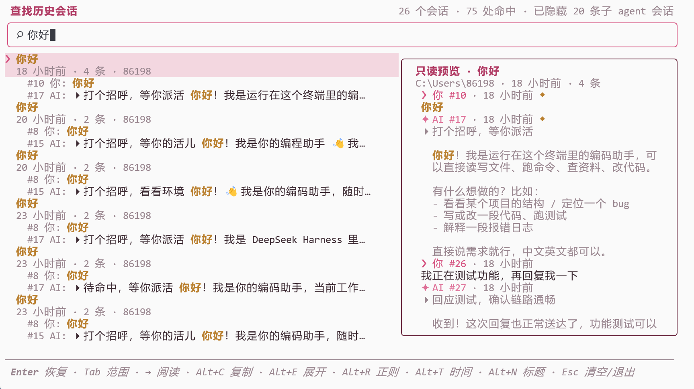

# dsh-tui-find


**dsh-TUI 的跨会话全文搜索插件** —— 对本机全部 dsh 会话（zstd 帧链 + 明文 JSONL）做即时增量搜索：命中可读、可复制、可恢复会话。

[English](./README.en.md) · MIT · 零第三方运行时依赖

- 仓库：https://github.com/xiaoxiaohaigui/dsh-tui-find
- npm：https://www.npmjs.com/package/dsh-tui-find

## 这是什么

[dsh-TUI](https://github.com/ccch1mneyyy/dsh-TUI) 有 resume 浏览器、会话内 `/` 搜索与 Ctrl+R 输入历史，但没有跨会话内容检索——对话滚出当前窗口就成了不可搜索的档案。本插件补上这一块：

- **即时**：fzf 式纯内存过滤，结果随扫描流式出现；多词 AND、JS 正则、拼音（全拼/首字母）、标题限定、时间窗口。
- **可读可复制**：split 分栏（左列表 · 右内容，/resume 同款风格）或全屏预览，锚定命中消息、命中词高亮，一键复制原文或日志路径。
- **可恢复**：`↵` 恢复会话，二次确认；右键上下文菜单（仅 0.10+ 宿主）。
- **侧栏常驻**（dsh-TUI 0.13.0+）：同一个单栏列表也住在右侧栏的面板里，侧栏开着就能直接打字搜索、点一行跳进全屏继续读。



## 安装

```bash
dsh plugin --profile dsh-tui add -w dsh-tui-find@latest
```

`--profile` 换成实际 profile 名（`$DSH_HOME/profiles/` 下的目录名，未设 `DSH_HOME` 时为 `~/.dsh`）。CLI 把包收录进 profile 的 bundle 列表并自动应用包内 `cordis.patch.yml`，无需手动改配置；安装 / 升级 / 卸载后重启 dsh-TUI（或 `/restart`）生效——宿主 `/reload` 不重载插件代码。

本地开发安装：`npm install && npm pack`（prepack 自动构建并跑全量测试），再 `dsh plugin --profile dsh-tui add -w ./dsh-tui-find-<版本号>.tgz`；不要直接安装源码目录。

## 升级与卸载

升级＝重跑安装命令（幂等）；版本未变先 `npm cache clean --force`，重启后用 `/plugins` 验证。卸载：`dsh plugin --profile dsh-tui remove -w dsh-tui-find`，重启生效。

若 profile `package.json → dsh.profile.bundles` 仍残留条目（CLI 版本差异），手动删除即可；`/settings` 保存过的设置在宿主那一侧（≤0.1.6 的 `settings.yaml`，或 ≥0.1.7 的 profile 补丁 `cordis.patch.yml`），重装后继续生效。卸载只影响本插件：会话数据全程只读、不受影响。

## 使用

| 操作 | 说明 |
|---|---|
| `/find <关键词>` | 带参直接出结果（空格分隔多词） |
| `/find` | 空参进全屏搜索场景 |
| `Alt+F` | 全局入口：按一次打开场景，**在场景里再按一次即退出**（`shortcut` 可改键或 `off`） |

场景内按键：

| 键 | 动作 |
|---|---|
| 任意字符 | 即时过滤；空查询列出最近会话 |
| `↑↓` / `PgUp` `PgDn` | 条目间移动 / 翻页 |
| `Tab` / `Alt+T` | 切换范围（本仓库 ⇄ 全部）/ 时间窗口（全部 ⇄ 近 7 天 ⇄ 近 30 天） |
| `Alt+R` / `Alt+N` | 切换正则匹配 / 仅搜索标题 |
| `→` / `←` | split 布局：右移聚焦右栏阅读窗，左移回到列表 |
| `Alt+P` | classic 布局：打开全屏预览（锚定命中消息、命中词高亮） |
| `Alt+C` / `Alt+E` | 复制命中原文 / 折叠、展开当前会话命中（与行尾 `▸ (+N)` 徽标同动作） |
| `Alt+H` | 键位帮助面板 |
| `↵` / `Esc` | 恢复会话（二次确认）/ 清空查询、返回、退出场景 |

鼠标：左键选中、悬停高亮、滚轮按宿主同样的档距移动选择（一档 ≈ 3 行；在阅读窗内则滚动阅读窗）。命中超过 3 条的会话在最后一条命中行右端显示 `▸ (+N)` 徽标，点它即展开该会话全部命中（展开后同一位置变 `▴ 收起`）——这是唯一一个不跟随整行点击的控件，整行点击仍是"选中并进入恢复确认"。右键开上下文菜单（仅 0.10+ 宿主）：复制消息文本 / 复制会话日志路径 / 恢复该会话。

几点行为说明：

- **布局**由 `layout` 配置选择：`split`（默认）在终端 ≥ 100 列时同屏显示"左侧列表 + 右侧会话内容阅读窗"（与 /resume 浏览器同风格）——选中项自动锚定右栏、右栏可独立滚动/复制/右键，`→` 聚焦右栏、`←` 回到列表（`Alt+P` 在 split 下不使用），窄终端自动回退单栏；`classic` 维持"单栏列表 + `Alt+P` 全屏预览"。
- **阅读窗没有光标**：`↑↓` 逐行滚动、`PgUp`/`PgDn` 与滚轮按档滚动，`n`/`N` 跳到视口之外的上一个/下一个命中（循环回绕）；`Alt+C` 复制的是当前命中（n/N 停驻的那条，或自由滚动后视口上方最近的一条，该会话没有命中时回退视口顶部那条消息）。命中落在消息深处、视口装不下时，阅读窗直接在命中行开窗，而不是停在看不到关键词的消息头。
- **结果**按会话分组、每会话默认展示前 3 条命中（`(+N)` 提示），最近优先；场景打开即开始扫描，结果随会话解析流式出现，头部实时显示进度。
- **预热**：启动约 10 秒后插件在后台预建一次索引（`warmup` 配置可关），此后首次 `/find` 即刻出列表；0.10+ 宿主在提示符上方显示"后台索引 n/m"进度行，点按即取消。预热只把冷解码挪到空闲期，不减少总解码量。

### 全局快捷键

默认是 `Alt+F` 而不是 `Ctrl+Shift+F`：主流终端把后者留给自身的"查找"功能并截获按键。冲突时用 `shortcut` 配置改成任意含 `Ctrl` 或 `Alt` 的组合键。

- 入口是**开关**：场景内再按同一个组合键直接退出（不论当时在列表、确认、预览还是帮助层），键位与 `shortcut` 配置一致；`Alt+H` 帮助表里列的就是生效键位，设为 `off` 时该行不显示。
- 把入口改到场景自己也用的键上（`alt+h`/`alt+t`/`alt+n`/`alt+p`/`alt+c`/`alt+e`）**宿主不会拒**，但**入口在场景内优先**：那个键会变成退出而不是它原本的功能。插件会在绑定落地时记一条 warn 并弹一次 toast，场景提示行也会一直标注「已被入口占用」。
- 反过来，**有些组合键宿主自己占着**，改过去不会生效：`alt+r`（宿主的 Continue）、`alt+s`/`alt+v`/`alt+z`，以及 `ctrl+b`/`ctrl+e`/`ctrl+g`/`ctrl+k`/`ctrl+l`/`ctrl+o`/`ctrl+p`/`ctrl+q`/`ctrl+r`/`ctrl+t`/`ctrl+v`/`ctrl+z` 一类（完整集合跟随宿主自己的动作键位）。这种情况注册会被拒绝、**插件保持原来的绑定**（默认仍是 `alt+f`），提示行会写着「未被宿主接受，实际入口 `Alt+F`」——设置卡片仍显示你填的值，以提示行为准。
- 以上提示的 toast 都以 `dsh-tui-find: ` 开头，方便在宿主通知区认出是哪来的。

### 侧栏面板（dsh-TUI 0.13.0+）

0.13.0 起 dsh-TUI 有右侧栏，插件会向其中注册一个「搜索」面板（`⌕` 标签），把上面那张单栏列表搬进侧栏——侧栏开着就能搜索，不必先开全屏。

| 键 / 操作 | 动作 |
|---|---|
| 任意字符 | 就地编辑查询（面板聚焦时键盘属于面板：未被消费的普通键由宿主吞掉，不会漏进聊天输入框） |
| `↑↓` / 滚轮 | 移动选择；`PgUp`/`PgDn` 翻页见下 |
| `Tab` | 切换搜索范围（本仓库 ⇄ 全部）——与全屏场景同一个键，切换后状态行用同一句提示确认 |
| `Shift+Tab`，或点行尾 `▸ (+N)` 徽标 | 折叠、展开当前会话命中 |
| `↵`，或点击**已选中**的行 | 打开全屏 `/find`，带着当前查询、选中行与当前范围定位过去（阅读、复制、恢复都在全屏里） |
| `Esc` | 清空查询；查询已空时交还宿主（焦点回聊天） |
| `←` `→` | 宿主回退键：切换面板（这是面板唯一不消费的普通键；`z`/数字/`[`/`]`/`+`/`-` 等都被面板当查询字符吃掉） |
| 悬停 / 单击 | 移动选择 / 选中；选中行再次单击即打开场景 |

- **让面板住进侧栏**：注册会把最终 id 追加进 `sidePanel.panels` 的**运行时**列表，但宿主随后拿**持久值整段覆盖**它（启动时的配置应用、以及每次写 `dsh-tui.sidePanel` 都会跑一遍）。所以**只靠注册不足以保证重启后面板出现**：`/settings › 侧栏 › 启用的面板` 是一张勾选页，插件面板会列成一行（标题是面板名，描述写作 `插件面板（act1）`），**勾上即把 `<actN>:search` 写进持久层**，重启后照旧生效；要调顺序或手写 id，用同页的「高级：编辑原始面板列表」。宿主 0.15.0 起（上游 #1441）配置应用时还会把「已注册但没持久化」的 id 并回列表，但本机 0.16.1 上仍遇到过需要勾一次的情况——**首次装好没看到面板，就去勾一次**，这是唯一可靠的路径。
- **想持久关掉就用 `panel: false`**（设置卡片首页有该行）：关掉时插件完全不注册；此时记得把勾选页里那一行的勾去掉（或在「高级」行删掉 `<actN>:search`），否则侧栏会留一个**无人认领的标签**——宿主给它回退名 `Search`，内容区显示第一个已启用面板（宿主语义，插件改不了）。
- **面板 id 由宿主分配**：插件只控制 `search` 这一段，`actN` 是宿主按激活顺序发的号，所以**每次重新注册都可能换号**（关了再开、宿主重载都会）。上游曾有一个把命名空间改成 `dsh-tui-find:search` 的 PR（#1474），**已关闭、未合并**——0.13.0–0.16.x 上看到 `act1:search` 这类写法是正常的，不要把某台机器上的 id 抄进配置或文档；换号后勾选页里旧行会显示为「暂无面板使用此 id」的占位行，删掉即可。
- **`PgUp`/`PgDn`**：0.13.0–0.14.0 上到不了面板——宿主的翻页守卫在把键交给侧栏之前就 `return` 了（`Chat` 里 `(key.pageUp || key.pageDown) && fullscreen`），而面板能收到键的唯一分发点在守卫之后。0.15.0 起那条守卫在面板聚焦时会先让位（`screens/Chat.js` 的翻页分支开头 `if (helpOpen || sidePanel.focus === 'panel') return;`，0.16.1 源码核对），插件的处理分支按宿主修复后的口径工作；全屏场景与阅读窗里的 `PgUp`/`PgDn` 一直不受影响。
- 面板收不到 `Ctrl`/`Alt` 组合键（宿主把它们放行给聊天），所以能用的修饰键只有 `Tab` 与 `Shift+Tab`：全屏里折叠用的 `Alt+E` **到不了面板**，折叠因此落在 `Shift+Tab`。面板沿用配置里的时间窗口 / 正则 / 标题限定；**范围可以在面板里用 `Tab` 切换**，当前范围常显在状态行，且只作用于本次插件激活、不写回配置——`/find` 与快捷键打开的场景仍从 `defaultScope` 起步，而面板 `↵` 交接过去的场景带着当前范围。拼音搜索（默认开）在面板里照常生效。
- 面板与全屏场景共用同一个扫描器、同一份内存索引，以及「同一时刻只跑一趟 sweep」的纪律：面板搜索时后台预热让位，反过来打开全屏场景会中止面板的扫描（回到面板时按已预热的缓存瞬间重建）。宿主对插件面板是「切到前台才挂载」，但查询、索引与选择由插件自己持有：切走再切回不丢状态、不重置查询；**每次切回会重扫一趟**，新建的会话与刚写进日志的消息都要搜得到——未变的日志只付一次 stat，增长的日志从上次偏移续解，刚写过的日志（1 s 内）多付一次重证读、片关闭后转暖；重扫期间列表与选中行原地不动，落定后一次性换成新结果。
- 中文输入：面板会把终端光标停在查询框的打字处，输入法候选框贴在面板里；这条走宿主内部的 hook，取不到时静默降级（候选框回到屏幕底部的聊天输入框），此时可用拼音打 `denglu` 找「登录」，或到全屏场景里输入。查询框空着、且面板持有键盘时，那一行只画光标、不画提示：组词期间插件收不到事件，提示放在那里只会被预上屏挤来挤去。

## 检索范围

- **索引**：用户消息、助手文本、会话标题；`indexTools` 开启后含工具调用摘要，`indexThinking` 开启后含 thinking 文本。
- **匹配**：默认大小写不敏感子串（CJK 天然正确，无分词依赖）；多词 AND（双引号短语保留内部空格、至多 16 词）；正则模式下整个查询是一个模式、不拆词。
- **拼音**（默认开，`pinyin` 可关）：纯字母词同时按拼音匹配汉字——全拼（`zhangsan` → 张三）、默认读音链（`zhongqing` → 重庆）、首字母（`zs` → 张三、`bjdx` → 北京大学，一个字母对一个字、可跨词连续）；全拼从音节起点匹配（不会把上一音节的尾字母接到下一字首字母）；多音字按全部读音参与，ü 按键盘习惯写作 v；内置 3500 常用字读音表，表外字按自身折叠；正则模式不扩展拼音。
- **标题限定**（`Alt+N` 即时切换）：只匹配会话标题、消息正文不参与——适合"找那个会话"；无标题会话不命中。
- **子 agent 会话**（默认不显示，`showSubagentSessions` 可开）：委派给子 agent 的运行各自是一条独立会话日志，默认不进列表也不进搜索索引——理由不是数量而是种类：那是模型自己的工作，不是你打开过的对话，与 `/resume` 浏览器"默认折叠"同一姿态。判据是会话头里的 `origin: subagent`：`/rewind` 分叉会话同样记录父会话却不是子 agent 运行，**始终可见**。隐藏了多少条由头部计数单列（形如「N 个会话 · 已隐藏 M 条子 agent 会话」）。开关只决定是否投递：被过滤的日志照样解码并留在内存索引里，所以打开开关不重读日志、关掉也不丢缓存。
- **默认范围**：本仓库（按会话 cwd 匹配当前工作目录，与 resume 浏览器同语义，含子目录会话）。

## 配置

在 `cordis.patch.yml` 的插件行上覆盖（全部可选）：

```yaml
- insert:
    - id: dsh-tui-find
      name: 'dsh-tui-find'
      defaultScope: 'all'        # 初始范围：repo(默认) | all
      defaultTime: 'all'         # 初始时间窗口：all(默认) | 7d | 30d
      layout: 'split'            # 界面布局：split(默认，左列表+右阅读窗，需≥100列) | classic(单栏+全屏预览)
      panel: true                # 侧栏搜索面板开关（默认开）
      caseSensitive: false       # 大小写敏感匹配（默认关）
      regex: false               # 默认启用正则匹配（默认关；场景内 Alt+R 即时切换）
      pinyin: true               # 拼音搜索（默认开；纯字母词同时按全拼/首字母匹配汉字）
      titleOnly: false           # 仅搜索标题（默认关；场景内 Alt+N 即时切换）
      showSubagentSessions: false # 显示子 agent 会话（默认关；/resume 浏览器同样默认折叠）
      indexTools: false          # 索引工具调用摘要（默认关）
      indexThinking: false       # 索引 thinking 文本（默认关）
      sessionRoot: ''            # 手动指定会话根目录（默认自动探测）
      maxMessageChars: 4000      # 单条消息索引字符上限
      warmup: true               # 后台预热索引（默认开；关闭后 /find 打开时才扫描）
      lang: 'auto'               # zh | en | auto(跟随宿主语言)
      shortcut: 'alt+f'          # 全局入口组合键：按一次进场景、场景内再按一次退出（必须含 ctrl 或 alt；'off' 关闭）
```

除 `lang` 外的选项都可以在 TUI 内直接改：`/settings` → **dsh-tui-find（会话搜索）** 卡片。卡片分两级：首页留日常旋钮（默认范围、默认时间、界面布局、全局快捷键），其余按「匹配方式」「索引」「高级」三张子页收拢，Enter 进入、Esc 返回。布尔/选择项一改即存，文本项回车确认；卡片文案跟随 TUI 语言。落点随宿主的设置服务世代而变：`@deepseek-ai/dsh-settings` ≤0.1.6 写进 `settings.yaml` 的用户层，≥0.1.7 写进当前 profile 的补丁（`cordis.patch.yml`）。

`lang: auto` 跟随 dsh-TUI 语言链：`DSH_TUI_LANG` → `~/.dsh-tui/lang.json` → 系统 locale → 中文，`/lang` 切换即时生效。

会话根目录按序探测（首个命中即用）：`sessionRoot` 配置（排他覆盖）→ `DSH_TUI_SESSION_ROOT` 环境变量 → `$DSH_HOME || ~/.dsh` + `/sessions` → `~/.dsh-tui/sessions`。

## 隐私与安全

- **全程只读**：只读打开会话日志，不触碰 history lock，不改写历史。
- **落盘最小化**：对话内容只存内存、绝不落盘。唯一例外是水位日志 `~/.dsh-tui/dsh-tui-find/watermark.json`——仅记录路径与字节/修改时间/偏移等元数据、绝无对话文本（0700/0600 + tmp+rename 原子写，`DSH_TUI_FIND_WATERMARK=off` 可关）。
- **世代命名**：dsh 的会话日志按格式世代命名（`session.jsonl`、`session.vN.jsonl`，各有 `.zstd` 压缩变体）。同一会话目录取**编号最高**的世代、同世代内压缩版优先——迁移窗口里并存的旧世代日志不会被索引。
- **增量解码与容错**：追加只解新增帧、同尺寸触碰零解码，缩水/改写/编码翻转自动回退全量；不完整尾帧按 RFC 8878 结构校验跳过，不崩溃、不残留。
- **恢复需确认**：恢复是丢弃当前上下文的破坏性切换，`↵` 二次确认，当前会话工作中给醒目警告。

## 开发

```bash
npm install          # 开发依赖
npm run build        # tsc → dist/
npm test             # pretest 自动构建并生成 fixture，vitest 全量
npm run verify:hosts # 宿主矩阵：隔离副本换宿主包，0.9.3、0.10.1、0.12.0、0.13.0、0.16.1 各跑一次 build+test
```

测试覆盖帧链解析、扫描器（变更令牌与戳片守卫、水位增量解码、世代枚举、子 agent 过滤）、搜索（多词 AND / 正则 / 拼音 / 标题限定 / 时间窗 / 范围）、正则回溯成本屏、预览阅读器与场景接线（真实宿主渲染器 + 鼠标注入）、共享列表模型、宿主代际分派与设置卡片、全局入口组合键的语法与占用判定等，逐项清单以 `test/` 下的用例为准。

## 环境要求

- dsh-TUI v0.9+（v0.15 community-draft 插件体系）；比 0.9.3 基线更新的能力一律软探测 + 优雅降级，不强制升级宿主
- 侧栏面板需要 dsh-TUI ≥ 0.13.0（`ctx.tuiPanels`）；更旧的宿主上零注册、零告警、行为不变
- Node `^22.19 || >=24`；Windows / macOS / Linux

## 许可

MIT
